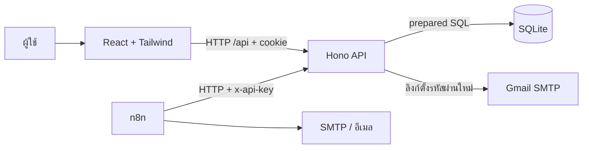

# ไล่อ่าน TaskFlow โดยเข้าใจหน้าที่ก่อนจำโค้ด

## 1. เริ่มจากสิ่งที่ผู้ใช้ทำ

ผู้ใช้เข้าสู่ระบบ เพิ่มงาน กำหนดวันส่ง แล้วกดเปลี่ยนสถานะ หัวใจของระบบคือ **งานแต่ละรายการมีเจ้าของหนึ่งคน** และ backend ตรวจเจ้าของทุกครั้ง n8n เป็นส่วนเสริมสำหรับเตือน ไม่ได้ทำหน้าที่แทนฐานข้อมูลหรือระบบ login



## 2. packages/shared/src/index.ts

อ่าน `taskSchema` ก่อน มันกำหนดว่างานที่ถูกต้องมีหน้าตาอย่างไร เช่น title อย่างน้อย 3 ตัวอักษร status อยู่ในสามค่าที่รู้จัก และ due_date ต้องเป็นวันที่มีจริง

**TypeScript type** ช่วยตรวจตอนเขียน/ build แต่ข้อมูลจาก HTTP ยังเป็นข้อมูลภายนอก **Zod schema** จึงต้องตรวจอีกครั้งตอน API ทำงาน หน้าเว็บใช้ schema เดียวกันเพื่อแสดงข้อผิดพลาดตั้งแต่ก่อนส่ง ส่วน backend ยังต้องตรวจเสมอ

Monorepo หมายถึงเก็บหลาย packages ใน repository เดียว `apps/web` และ `apps/api` จึง import `@taskflow/shared` ได้ npm workspaces เป็นตัวเชื่อม packages ไม่ใช่ตัวรัน backend ให้เอง

## 3. apps/api/src/schema.sql และ db.ts

ตาราง `users` เก็บบัญชี `tasks` เก็บงานและ `user_id` ที่อ้างอิงเจ้าของ `auth_sessions` เก็บ session ที่ยกเลิกได้ `api_keys` เก็บ digest ของ key และ `reminder_deliveries` เก็บประวัติเตือน

`password_reset_tokens` เก็บ `token_hash`, `expires_at`, `used_at` และเจ้าของ token เพื่อให้ลิงก์ตั้งรหัสผ่านมีอายุจำกัดและใช้ได้ครั้งเดียว ไม่เก็บ token ฉบับเต็มหรือรหัสผ่านใหม่แบบ plaintext

Primary key ระบุแถว Foreign key ผูกข้อมูลเข้าหากัน CHECK ปฏิเสธ status/priority ที่ไม่รู้จัก UNIQUE ป้องกันอีเมลหรือใบรับแจ้งเตือนซ้ำ Index ช่วยค้นตาม user_id/status/due_date

SQLite เป็น SQL database แบบไฟล์ จึงเปิดเดโมได้โดยไม่ติดตั้ง database server โค้ดนี้ใช้ DatabaseSync ทำให้ query เป็น synchronous เหมาะกับงานเล็ก แต่ต้องประเมินเมื่อมีผู้ใช้จำนวนมาก

## 4. apps/api/src/app.ts และ context.ts

`createApp()` ประกอบ middleware และ routes ลำดับโดยย่อคือ request ID, security headers, body limit, Origin check, rate limit เฉพาะเส้นทาง auth ที่กำหนด, authentication สำหรับเส้นทางที่ต้อง login แล้วจึงเรียก handler เส้นทาง forgot/reset password เป็นสาธารณะที่มี limit แยกกัน

Middleware คือโค้ดที่ทำงานก่อน/หลัง handler และส่งต่อด้วย `next()` เหมาะกับกติกาที่ทุก route ต้องใช้ร่วมกัน `parseBody()` ตรวจ JSON + Zod และ error handler ทำให้ frontend รับรูปแบบ error เดียวกัน

Origin check ช่วยปฏิเสธคำขอแก้ข้อมูลจากเว็บอื่น มันไม่ได้แทน authentication และ CORS ก็ไม่ได้ยืนยันว่าใครมีสิทธิ์ทำอะไร

## 5. apps/api/src/security.ts และ auth.ts

สมัคร: ตรวจ input แล้วใช้ **scrypt + salt** สร้าง password hash เก็บ hash แทนรหัสผ่านจริง Salt เป็นค่าสุ่มแต่ละบัญชี ทำให้รหัสผ่านเหมือนกันได้ hash ต่างกัน

Login: ตรวจรหัสผ่าน สร้าง session ใน SQL แล้วออก JWT ที่มี subject(user ID), session ID และวันหมดอายุ Browser รับ JWT ใน HttpOnly cookie

Request ถัดไป: `sessionMiddleware()` ตรวจ signature, algorithm, issuer, audience และ expiration จากนั้นตรวจ session ใน SQL ว่ายังไม่ถูกยกเลิก แล้วดึง user จาก DB

JWT ใช้ลายเซ็นตรวจว่าข้อมูลถูกแก้หรือไม่ Payload ของ JWT อ่านได้ จึงไม่ใส่ password หรือ secrets HttpOnly ช่วยไม่ให้ JavaScript อ่าน cookie โดยตรง แต่หน้าเว็บที่มี XSS ยังอาจส่ง request ในนามผู้ใช้ได้

Logout: ยกเลิก session ใน SQL และลบ cookie ดังนั้น token ที่คัดลอกก่อน logout ก็ไม่ผ่าน session check อายุ JWT 5 ชั่วโมง ไม่มี refresh flow เพื่อลดขอบเขตที่ต้องเข้าใจ

### 5.1 password-reset.ts และ mail.ts

ผู้ใช้กด **ลืมรหัสผ่าน?** แล้วส่งอีเมลไป `POST /api/auth/forgot-password` เมื่อ SMTP ตั้งค่าแล้ว API ตอบ 202 ด้วยข้อความกลาง ไม่บอกว่ามีบัญชีหรือไม่ สำหรับบัญชีที่มีอยู่และยังไม่เกิน limit ระบบสุ่ม token 32 bytes เก็บเฉพาะ SHA-256 digest ใน SQL และกำหนดอายุ 5 นาที

`mail.ts` ใช้ Nodemailer ส่งอีเมลผ่าน Gmail SMTP โดยอ่าน credential จาก `.env` ฝั่ง server และสร้างลิงก์จาก `APP_PUBLIC_URL` ที่ตั้งไว้ ลิงก์เป็น `/reset-password#token=...` แทนการสร้าง host จาก request ของผู้เรียก การตั้ง App Password และ URL อธิบายทีละขั้นใน [คู่มือลืมรหัสผ่าน](password-reset-gmail.md) งานนี้ส่งจาก backend โดยตรง ไม่ผ่าน n8n

การส่งเริ่มหลังรับคำขอด้วยงาน async ใน process ถ้าส่งล้มเหลวจะลบ token ที่ยังไม่ใช้และ log `password_reset_email_failed` โดยไม่เก็บ secret การตอบ 202 จึงไม่ใช่หลักฐานว่าอีเมลถึง inbox และงานที่รอส่งไม่มี durable queue ต้องขอลิงก์ใหม่หาก process หยุดก่อนส่ง

เมื่อตั้งรหัสใหม่ `POST /api/auth/reset-password` จะตรวจ token และ hash รหัสใหม่ด้วย scrypt จากนั้นทำ **SQL transaction**: claim token โดยอัปเดตได้เฉพาะแถวที่ยังไม่ใช้และไม่หมดอายุ เปลี่ยน password hash เพิกถอนทุก session และทำให้ token อื่นของบัญชีใช้ต่อไม่ได้ ถ้า claim ไม่สำเร็จต้อง rollback จึงไม่เกิดการตั้งรหัสผ่านซ้ำด้วยลิงก์เดียวกัน ผู้ใช้ login ใหม่เองหลังสำเร็จ

หัวใจที่ต้องตอบได้: token สุ่มที่เดายากใช้ SHA-256 digest สำหรับ lookup ส่วนรหัสผ่านที่คนตั้งใช้ scrypt เพื่อเพิ่มต้นทุนการเดา ข้อความกลางช่วยไม่เปิดเผยการมีบัญชี Limit ต่อ IP คือขอลิงก์ 5 ครั้ง/15 นาทีและตั้งรหัส 10 ครั้ง/15 นาที ต่อบัญชีเว้น 60 วินาทีและสร้างลิงก์ได้ 3 ครั้ง/ชั่วโมง โดยยังตอบข้อความกลาง

## 6. apps/api/src/tasks.ts

จุดสำคัญตอน code review:

```sql
SELECT id,title,description,priority,status,due_date,created_at,updated_at
FROM tasks
WHERE id = ? AND user_id = ?;
```

`id` เลือกงาน ส่วน `user_id` ตรวจเจ้าของ ข้อมูลผู้ใช้มาจาก session ที่ตรวจแล้ว ไม่อ่าน user_id จากฟอร์ม การไม่พบงานของคนอื่นคืน 404 เช่นเดียวกับ ID ที่ไม่มี เพื่อไม่เผยว่ารายการนั้นมีอยู่

Prepared parameters ส่งข้อมูลแยกจากคำสั่ง SQL จึงไม่ต่อชื่อ task/คำค้นหาเข้า SQL โดยตรง ชื่อ column ใน filters มาจากโค้ดที่กำหนดไว้ ค่า filters ผ่าน enum validation

PATCH แก้เฉพาะ fields ที่ส่งมา ตัวอย่างส่งแค่ status จะไม่ลบ description หรือ due_date ส่วน DELETE ลบด้วยเงื่อนไข id + user_id เช่นกัน

## 7. Frontend

ไล่จากการ submit ฟอร์ม: state เก็บ input, shared schema ตรวจ, fetch เรียก /api, loading ป้องกันกดซ้ำ, response อัปเดตรายการ, error แสดงข้อความให้ผู้ใช้ Browser ส่ง cookie ให้ตามเงื่อนไขเอง ไม่ต้องอ่าน JWT ด้วย JavaScript

Tailwind เป็น utility classes สำหรับจัด layout สี ระยะห่าง และ responsive แทนการเขียน CSS แยกทุก component สีในงานนี้กำหนดจากภาพอ้างอิงของผู้ใช้

ใน dev Vite proxy ส่ง `/api` ไป Hono ที่ port 3000 Browser จึงเรียก URL ของเว็บตัวเอง หลัง build Hono เสิร์ฟทั้งไฟล์ frontend และ API จาก origin เดียว

ฟอร์มวันที่อ่านค่าจริงจาก input ผ่าน FormData ตอน submit และรับ onInput/onChange เพื่อไม่ให้ค่าที่ผู้ใช้เลือกหายระหว่างการอัปเดต state การทดสอบผ่านหน้าเว็บเป็นตัวที่ช่วยพบปัญหานี้ แม้ typecheck จะผ่านก็ตาม

หน้า reset อ่าน token จาก URL fragment แล้วลบ fragment ออกจากแถบที่อยู่ก่อนแสดงหน้า เก็บ token ไว้ใน React memory เท่านั้น ผู้ใช้กรอกรหัสใหม่ 8–16 ตัวอักษรและยืนยันให้ตรงกันก่อนเรียก API การ refresh ทำให้ token ใน memory หาย ต้องเปิดลิงก์ต้นฉบับจากอีเมลอีกครั้งหรือขอใหม่ถ้าหมดอายุ/ใช้แล้ว

## 8. apps/api/src/integrations.ts และ n8n

API key เป็น credential สำหรับ automation ไม่ใช่บัญชีผู้ใช้ในหน้าเว็บ สร้างด้วย random bytes ที่คาดเดายาก คืน secret ครั้งเดียว และเก็บ SHA-256 digest สำหรับเปรียบเทียบเมื่อ n8n ส่ง `x-api-key` keyมี owner, scope, expires_at, revoked_at

SHA-256 เหมาะกับ key ที่สุ่ม entropy สูง ส่วน password ที่คนตั้งต้องใช้ algorithm ที่ช้ากว่าเช่น scrypt เพื่อเพิ่มต้นทุนการเดารหัสผ่าน

n8n อ่าน due tasks ของเจ้าของ key ส่งอีเมลผ่าน SMTP แล้วจึงบันทึก receipts ผ่าน API ไม่มีการเปิด SQL ให้น8nอ่านตรง ๆ UNIQUE ทำให้การบันทึกซ้ำไม่สร้างแถวซ้ำ แต่การส่งอีเมลกับบันทึกเป็นคนละระบบ จึงไม่อ้างว่าไม่มีทางส่งซ้ำ

## 9. วิธีซ้อมก่อนนำเสนอ

เริ่ม server และ login เดโม เพิ่มงานที่กำหนดส่งวันนี้ เปลี่ยนสถานะ สลับ filter แล้วเปิด schema/route ที่เกี่ยวข้อง ลองสมัครบัญชีอีกคนเพื่ออธิบายเจ้าของข้อมูล สร้าง key แสดงว่าหน้า list ไม่คืน secret และยกเลิก key เพื่อแสดงว่าคำขอเดิมใช้ไม่ได้

ถ้ายังไม่มี SMTP ให้สาธิตการ GET due tasks ด้วย key และเปิด workflow อธิบายทีละ node พร้อมบอกตรง ๆ ว่ายังไม่ได้ส่งอีเมล อย่าเรียก receipt เองแล้วอ้างว่าส่งอีเมลสำเร็จ

สำหรับ demo ลืมรหัสผ่าน ให้ใช้บัญชีที่สมัครด้วยอีเมลรับจริงและตั้ง SMTP ก่อน บัญชีเดโม `.local` รับเมลไม่ได้ รัน `npm run mail:check` เพื่อตรวจ SMTP login แบบไม่ส่งอีเมล แล้วค่อยลองจากหน้าเว็บ การทดสอบกับ SMTP จำลองในเครื่องไม่ได้พิสูจน์ว่าส่งผ่าน Gmail จริงแล้ว
