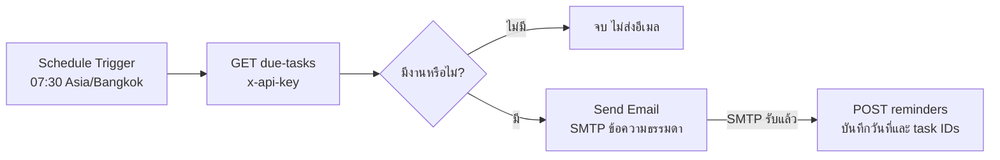

# n8n: อีเมลเตือนงาน TaskFlow ทุกเช้า

ส่วนเสริมนี้เตรียม workflow ให้ import ได้ แต่ยังไม่ได้เชื่อม SMTP ของผู้ใช้หรือส่งอีเมลจริง เว็บ To-do ใช้งานได้โดยไม่เปิด n8n

ไฟล์ workflow คือ [taskflow-daily-reminder.json](../n8n/taskflow-daily-reminder.json) ส่วน [docker-compose.yml](../n8n/docker-compose.yml) ใช้เมื่อเลือกติดตั้ง n8n ใน Docker เท่านั้น

## Flow และหน้าที่ของแต่ละขั้น



1. **Schedule Trigger:** เริ่ม workflow วันละครั้ง 07:30 น. ตามประเทศไทย ต้อง Save และ Publish/Activate จึงรันอัตโนมัติ [n8n Schedule Trigger](https://docs.n8n.io/integrations/builtin/core-nodes/n8n-nodes-base.scheduletrigger/)
2. **HTTP Request — Get due tasks:** ขอรายการเฉพาะเจ้าของ API key ไม่อ่าน SQL โดยตรง ใช้ Header Auth credential สำหรับ `x-api-key`
3. **If — Has due tasks?:** ตรวจ `tasks.length > 0`; กรณีไม่มีงานหยุดโดยไม่ส่งอีเมล
4. **Send Email:** ส่งสรุปชื่อ/กำหนดส่ง/ความสำคัญ/สถานะ ไปยัง `user.email` ที่ API คืนมา ใช้ข้อความธรรมดา จึงไม่ตีความชื่อ task เป็น HTML [n8n Send Email](https://docs.n8n.io/integrations/builtin/core-nodes/n8n-nodes-base.sendemail/)
5. **HTTP Request — Record sent reminders:** ทำหลัง Send Email สำเร็จ ส่ง ID และวันที่จากผล GET เดิมเพื่อบันทึกประวัติ ข้อมูลไม่ได้มาจาก output ของ SMTP ซึ่งมีคนละรูปแบบ [n8n HTTP Request](https://docs.n8n.io/integrations/builtin/core-nodes/n8n-nodes-base.httprequest/)

## 1. เตรียม TaskFlow

ทำ setup และเปิด frontend/backend ตาม README ของโปรเจกต์ ให้ API ทำงานที่ port 3000 จากนั้น:

- สมัครบัญชีด้วยอีเมลที่ต้องการรับการเตือนจริง บัญชีตัวอย่างสำหรับเดโมไม่ใช่กล่องอีเมลรับข้อความ
- สร้าง task ที่ยังไม่ completed และกำหนด `due_date` เป็นวันนี้หรือวันก่อนหน้า
- เปิดส่วน API key ในเว็บ สร้าง key สำหรับ reminders และคัดลอก secret ที่แสดงครั้งเดียว
- Key ผูกกับผู้ใช้ที่สร้าง key นั้น; workflow หนึ่งชุดใช้ key ของผู้ใช้หนึ่งคน ถ้ามีคนเพิ่ม ให้ copy workflow และเลือก credential ของเจ้าของคนนั้น

Key ไม่ได้ให้สิทธิ์ login ผ่านเว็บหรืออ่านงานของผู้ใช้อื่น และต้องเปลี่ยน credential ใน n8n เมื่อหมุน key หรือ key หมดอายุ

## 2. เลือกวิธีเปิด n8n

### มี n8n ติดตั้งบนเครื่องเดียวกับ TaskFlow อยู่แล้ว

เปิด editor ของ n8n ที่ใช้อยู่ Workflow ที่ให้มามี URL เริ่มต้น `http://localhost:3000` จึงไม่ต้องเปลี่ยน URL และ API ใช้ `HOST=127.0.0.1` ตามค่าเริ่มต้นได้

### ใช้ Docker Desktop บน Windows

Compose นี้มี n8n เพียง service เดียว ใช้ SQLite ของ n8n และ named volume เก็บ workflow/credentials ไม่ต้องเปิด PostgreSQL เพิ่ม รุ่นถูก pin เป็น **2.43.4** ซึ่ง release ทางการวันที่ 12 ตุลาคม 2026 และตรวจพบเป็น stable ณ วันที่จัดทำไฟล์ [n8n release 2.43.4](https://github.com/n8n-io/n8n/releases/tag/n8n@2.43.4)

จาก root ของโปรเจกต์:

```powershell
docker compose -f n8n/docker-compose.yml up -d
docker compose -f n8n/docker-compose.yml ps
```

เปิด [http://localhost:5678](http://localhost:5678) และสร้าง owner account ของ n8n ตามหน้าตั้งค่าครั้งแรก Compose เปิดพอร์ตเฉพาะ `127.0.0.1`, ตั้ง timezone ไทย และใช้ HTTP cookie สำหรับ local demo หากจะเปิดผ่าน HTTPS ภายนอกต้องปรับ configuration ตามเอกสาร deployment ของ n8n

**ความต่างของ localhost:** ภายใน container, localhost คือ container เอง ไม่ใช่ Windows ที่รัน API จึงเปลี่ยน URL ใน HTTP Request ทั้งสอง node เป็น:

```text
http://host.docker.internal:3000/api/integrations/due-tasks
http://host.docker.internal:3000/api/integrations/reminders
```

ตั้ง `HOST=0.0.0.0` ใน `.env` ของ TaskFlow และ restart API เมื่อจำเป็นสำหรับ Docker เพื่อให้ API รับ connection จากเครือข่าย Docker การตั้งค่านี้ทำให้ API listen บน network interfaces ด้วย คงใช้ API key และกำหนด firewall ให้เฉพาะการเชื่อมต่อที่ใช้ ไม่ต้องเปลี่ยน `APP_ORIGIN` เพื่อให้ n8n เรียก: CORS ใช้กับ browser ส่วน server-to-server ใช้ credential [Docker Desktop networking](https://docs.docker.com/desktop/features/networking/)

เก็บ named volume ไว้ เพราะมีฐานข้อมูลและ encryption key สำหรับ credentials หยุดได้ด้วย `docker compose -f n8n/docker-compose.yml stop` โดยไม่ลบข้อมูล [n8n Docker image และ storage](https://github.com/n8n-io/n8n/blob/master/docker/images/n8n/README.md)

## 3. Import และตั้ง Credentials

1. ใน n8n สร้าง workflow แล้วเลือก **Import from File** เลือก `n8n/taskflow-daily-reminder.json` ไฟล์ตั้ง `active: false` จึงยังไม่เปิด schedule อัตโนมัติ
2. เปิด **Get due tasks** → Authentication: **Generic Credential Type** → **Header Auth** → Create credential ตั้งชื่อ credential เช่น `TaskFlow personal reminders` โดยกำหนด **Name = `x-api-key`**, **Value = secret key จาก TaskFlow**
3. เปิด **Record sent reminders** และเลือก Header Auth credential เดียวกัน
4. เปิด **Send task summary** → เลือก/สร้าง **SMTP credential** ใส่ host, port, username/password หรือ app password ตามผู้ให้บริการ ตั้ง TLS/SSL ตามผู้ให้บริการและคงการตรวจ certificate เปิดอยู่ ดู [n8n SMTP credentials](https://docs.n8n.io/integrations/builtin/credentials/send-email/)
5. เปลี่ยน **From Email** จาก `your-smtp-address@example.com` เป็นอีเมลที่ SMTP อนุญาตให้ส่งจริง **To Email** เป็น expression `user.email` อยู่แล้ว
6. หาก build แล้วเปิดเว็บที่ port 3000 ให้เปลี่ยนลิงก์ในข้อความอีเมลจาก `http://localhost:5173` เป็น `http://localhost:3000`; ถ้าใช้งานภายนอกให้ใช้ URL ที่ผู้รับเข้าถึงได้
7. เปิด workflow settings ตรวจ timezone **Asia/Bangkok** และเลือก Save

ไฟล์ JSON นี้ไม่เก็บ API key, SMTP password หรือ credential IDs ของใคร ต้องเลือก credentials ใน editor หลัง import นโยบายของ SMTP แต่ละผู้ให้บริการอาจต่างกัน จึงใช้ค่า host/port/วิธียืนยันจากเอกสารของผู้ให้บริการที่คุณเลือก

## 4. ทดสอบทีละขั้นก่อนเปิดเวลาอัตโนมัติ

ขั้นตอนต่อไปนี้สำหรับผู้ใช้ทำหลังใส่ credentials การ execute ทั้ง workflow จะส่งอีเมลจริงไปยังบัญชีของผู้ใช้

| การทดสอบ | ผลที่ควรได้ |
| --- | --- |
| Execute Get due tasks ด้วย key ที่ถูกต้อง | JSON ของเจ้าของ key และงานที่ค้างถึงวันนี้ |
| ไม่มี due tasks | If ออกฝั่ง false; Send Email ไม่ทำงาน |
| มีงานครบกำหนดหนึ่งรายการ | If ออก true; แสดงงานหนึ่งรายการในข้อความ |
| ทดสอบเต็ม flow ด้วย SMTP ของตัวเอง | SMTP ตอบรับ แล้ว Record sent reminders สำเร็จ |
| รัน GET ซ้ำในวันเดียวหลังบันทึกสำเร็จ | งานที่บันทึกแล้วไม่อยู่ในผล GET |
| ตั้งสถานะ completed ก่อน GET | งานนั้นไม่ถูกส่งกลับ |
| ใช้ key ที่ถูกเพิกถอน/หมดอายุ | API ปฏิเสธ; workflow หยุดก่อนส่งอีเมล |
| SMTP ล้มเหลว | workflow หยุด; ไม่เรียก Record sent reminders |

เมื่อทดสอบเรียบร้อย เลือก **Publish/Activate** ตามรุ่น editor ถ้า n8n หรือ API ไม่เปิดในเวลานัด จะไม่ได้อีเมลของรอบนั้น Workflow นี้ไม่ได้ตั้ง catch-up ให้เวลาที่ระบบหยุด

## สัญญาข้อมูลระหว่าง n8n กับ API

`GET /api/integrations/due-tasks` พร้อม Header Auth คืนรูปแบบ:

```json
{
  "date": "2026-10-13",
  "user": { "name": "ผู้ใช้ตัวอย่าง", "email": "you@example.com" },
  "tasks": [
    {
      "id": "task-id-from-api",
      "title": "ส่งรายงาน",
      "description": "ตรวจเนื้อหาก่อนส่ง",
      "priority": "high",
      "status": "pending",
      "due_date": "2026-10-13"
    }
  ]
}
```

เมื่อ GET ไม่ส่ง query, API กำหนด `date` เป็นวันนี้ของประเทศไทย และเลือกเฉพาะงานที่ยังไม่ completed, `due_date <= date` และไม่มีประวัติเตือน email ของวันเดียวกัน ไม่ส่งงานที่ไม่มี due date Workflow นี้ไม่ส่ง date เองใน GET ส่วน API รองรับ `?date=YYYY-MM-DD` สำหรับตรวจรายการของวันที่ระบุด้วย โดยยังตรวจรูปแบบวันที่และจำกัดเฉพาะเจ้าของ key

หลัง SMTP ตอบรับ ส่ง `POST /api/integrations/reminders` ด้วย key เดียวกัน:

```json
{
  "task_ids": ["task-id-from-api"],
  "date": "2026-10-13",
  "channel": "email"
}
```

นี่เป็น **บันทึกการเตือนหลัง SMTP รับส่งต่อ** ไม่ใช่หลักฐานว่าอีเมลเข้ากล่องผู้รับ การที่ user เปิดอ่านไม่ได้ถูกติดตามในระบบนี้

## การส่งซ้ำและข้อจำกัดที่ต้องอธิบายได้

SQL มี unique key สำหรับ user/task/date/channel ช่วยไม่ให้บันทึกประวัติซ้ำ และ GET ไม่เลือกงานที่บันทึกแล้ว แต่นั่นยังไม่ใช่ exactly-once delivery:

- ถ้า SMTP ส่งสำเร็จแต่ API บันทึกล้มเหลวหรือโปรเซสหยุดระหว่างสองขั้น อีเมลอาจส่งซ้ำในการรันถัดไป
- ถ้ารันสอง workflow พร้อมกันด้วย key เดียว ทั้งคู่อาจ GET ก่อนมีประวัติแล้วส่งซ้ำได้ จึงใช้ workflow ที่ active เพียงหนึ่งชุดต่อ key และไม่กด execute ซ้อนกับรอบเวลานัด
- Record sent reminders retry ได้ถึง 3 ครั้ง ส่วน Send Email ไม่ตั้ง retry อัตโนมัติเพื่อลดความเสี่ยงส่งซ้ำจากการ timeout หลัง SMTP รับแล้ว
- งานที่ยังค้างอาจถูกเตือนอีกครั้งในวันถัดไป นี่เป็น daily reminder ตามที่ออกแบบ
- API คืนงานสูงสุด 100 รายการต่อครั้ง และ workflow ส่งหนึ่งสรุปต่อรอบ หากงานครบกำหนดเกิน 100 รายการต้องเพิ่มการแบ่ง batch/pagination มิฉะนั้นงานที่อยู่ถัดจาก 100 รายการแรกอาจไม่ได้รับการเตือน
- SMTP accepted ยังอาจตามด้วย bounce/spam; ระบบนี้ไม่มี inbox tracking หรือ bounce webhook

งานระดับกลางนี้เลือกความเรียบง่าย หากต้องการความน่าเชื่อถือสูงขึ้น ค่อยเพิ่มคิว/outbox และ claim งานก่อนส่ง โดยต้องออกแบบ retry และ provider idempotency ร่วมกัน

## สถานะการตรวจสอบไฟล์ที่ส่งมอบ

ตรวจ JSON parse, รายชื่อ/การเชื่อม nodes, timezone/schedule, รูปแบบ POST และ JavaScript expressions ด้วยข้อมูลจำลองใน `n8n/validate-workflow.mjs` แล้ว ไม่ได้ import/execute ใน n8n server ที่รันจริง และไม่ได้ทดสอบ SMTP จึงยังต้องทดสอบ integration ตามตารางข้างต้นหลังผู้ใช้ตั้ง credentials

```powershell
node n8n/validate-workflow.mjs
```

พารามิเตอร์อ้างอิงจากเอกสารทางการและ source ของ [Schedule Trigger](https://github.com/n8n-io/n8n/blob/master/packages/nodes-base/nodes/Schedule/ScheduleTrigger.node.ts), [HTTP Request](https://github.com/n8n-io/n8n/blob/master/packages/nodes-base/nodes/HttpRequest/V3/Description.ts), [If](https://github.com/n8n-io/n8n/blob/master/packages/nodes-base/nodes/If/V2/IfV2.node.ts) และ [Send Email](https://github.com/n8n-io/n8n/blob/master/packages/nodes-base/nodes/EmailSend/v2/send.operation.ts) โดยอ่าน source สาขา master ที่เข้าถึงได้ ไม่ได้รันทดสอบ node ใน image 2.43.4 จริง
