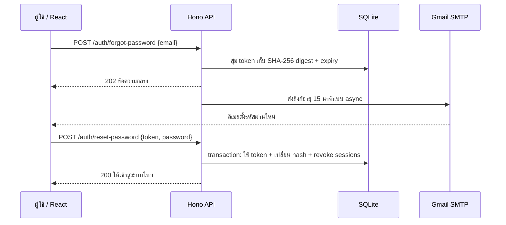

# ตั้งค่า “ลืมรหัสผ่าน” ด้วย Gmail SMTP

คู่มือนี้ทำให้ TaskFlow ส่งลิงก์ตั้งรหัสผ่านใหม่จาก Gmail ของคุณ ผู้ใช้กด **ลืมรหัสผ่าน?** ที่หน้าเข้าสู่ระบบ เปิดอีเมล แล้วตั้งรหัสผ่านใหม่ได้ โดยไม่ต้องเปิด n8n

**Gmail เป็นบัญชีผู้ส่ง** ส่วนผู้รับใช้อีเมลผู้ให้บริการใดก็ได้ที่รับข้อความได้ ต้องกรอกอีเมลเดียวกับที่สมัคร TaskFlow บัญชี `demo@taskflow.local` รับอีเมลจริงไม่ได้ ให้สมัครบัญชีด้วยอีเมลของคุณเพื่อทดลอง

## 1. เตรียม App Password ของ Google

TaskFlow รุ่นนี้ใช้ SMTP พร้อม App Password ยังไม่มีการเชื่อมแบบ Google OAuth ให้สร้างรหัสเฉพาะแอปสำหรับ TaskFlow แทนรหัสผ่าน Gmail ปกติ

1. เข้าบัญชี Google ที่จะใช้ **ส่ง** อีเมล
2. เปิด **2-Step Verification** ในหน้าความปลอดภัยของบัญชี
3. เปิด [App Passwords ของ Google](https://myaccount.google.com/apppasswords) ตั้งชื่อ เช่น `TaskFlow local` แล้วสร้างรหัส
4. เก็บ App Password 16 ตัวที่ Google แสดงไว้ใน `.env` บนเครื่องของคุณ ไม่ส่งรหัสนี้ในแชต ภาพหน้าจอ หรือ Git

บางบัญชีไม่มีเมนู App Passwords เช่น บัญชีองค์กรที่มีนโยบายจำกัด บัญชีที่ใช้ Advanced Protection หรือการยืนยันสองขั้นตอนบางรูปแบบ ตรวจเงื่อนไขที่ [คำแนะนำ App Passwords ของ Google](https://support.google.com/accounts/answer/185833?hl=en) หากบัญชีไม่มีสิทธิ์ใช้งาน ให้ปรึกษาผู้ดูแลบัญชี Google ระบุว่า App Password ต้องเปิด 2-Step Verification และการเปลี่ยนรหัสผ่านบัญชี Google จะเพิกถอน App Password เดิมด้วย

## 2. เตรียมไฟล์ตั้งค่า

เปิด Terminal ในโฟลเดอร์ TaskFlow แล้วรัน:

```powershell
npm run setup
npm run setup:email
```

`setup` สร้าง `.env` พร้อม JWT secret เมื่อยังไม่มีไฟล์ ส่วน `setup:email` เติมตัวแปรอีเมลที่ขาด โดยรักษาค่าที่มีอยู่แล้ว จากนั้นเปิด `.env` ด้วย editor ของคุณและกำหนดค่าต่อไปนี้ ตัวอย่างใช้ placeholder ไม่ใช่ข้อมูลบัญชีจริง

```dotenv
SMTP_HOST=smtp.gmail.com
SMTP_PORT=465
SMTP_SECURE=true
SMTP_USER=your-sender@gmail.com
SMTP_PASS=YOUR_GOOGLE_APP_PASSWORD
SMTP_FROM=
SMTP_FROM_NAME=TaskFlow
APP_PUBLIC_URL=http://localhost:5173
```

| ตัวแปร | ใส่อะไร / ใช้ทำอะไร |
| --- | --- |
| `SMTP_HOST` | `smtp.gmail.com` คือ server ส่งอีเมลของ Gmail |
| `SMTP_PORT` | `465` ใช้คู่กับ `SMTP_SECURE=true` เพื่อเชื่อมต่อแบบ TLS ตั้งแต่เริ่ม |
| `SMTP_USER` | อีเมล Gmail ของผู้ส่งแบบเต็ม |
| `SMTP_PASS` | App Password ของบัญชีผู้ส่ง ไม่ใช่รหัสผ่านเข้าบัญชี Google ปกติ |
| `SMTP_FROM` | เว้นว่างเพื่อใช้ `SMTP_USER` เป็นที่อยู่ผู้ส่ง เริ่มต้นแบบนี้ได้เลย |
| `SMTP_FROM_NAME` | ชื่อผู้ส่งที่แสดง ค่าเริ่มต้นคือ `TaskFlow` |
| `APP_PUBLIC_URL` | URL ของ **หน้าเว็บที่ผู้รับจะเปิด** ใช้สร้างลิงก์ในอีเมล |

หาก Google แสดง App Password เป็นกลุ่ม ให้คัดลอกให้ครบ โค้ดเชื่อม Gmail จะตัดช่องว่างออกก่อนใช้ เก็บตัวแปร SMTP ที่ backend เท่านั้น อย่าเพิ่ม prefix `VITE_` ให้ secret เพราะตัวแปรที่ frontend นำไปใช้จะถูกส่งถึง browser ค่าของ server อ่านตอนเริ่ม process จึงต้องหยุดและเปิด TaskFlow ใหม่หลังแก้ `.env`

ค่า Gmail host และ port อ้างอิง [Google: ส่งอีเมลจากแอปผ่าน Gmail SMTP](https://support.google.com/a/answer/176600?hl=en) คู่มือนี้ใช้เฉพาะการตั้งค่า `smtp.gmail.com` ไม่ได้ใช้ SMTP relay ขององค์กร

## 3. เลือก APP_PUBLIC_URL ให้ตรงวิธีรัน

| วิธีใช้ | `APP_PUBLIC_URL` |
| --- | --- |
| `npm run dev` เปิดเว็บบนเครื่อง server | `http://localhost:5173` |
| `npm run build` แล้ว `npm start` บนเครื่อง server | `http://localhost:3000` |
| เปิดใช้งานผ่าน domain จริง | เช่น `https://tasks.example.com` |

ใส่เฉพาะ origin คือ protocol, hostname และ port ถ้ามี ไม่ใส่ `/reset-password`, query string หรือ `#token` โปรแกรมเติม path และ token เอง ใน production ต้องใช้ HTTPS และตั้ง `NODE_ENV=production` พร้อม `APP_ORIGIN` ให้ตรง origin ที่อนุญาต

**`localhost` หมายถึงเครื่องที่กำลังเปิดลิงก์** หาก server อยู่บนคอมพิวเตอร์ แต่เปิดอีเมลจากมือถือ ลิงก์ localhost จะชี้ไปที่มือถือ ให้ทดลองเปิดจาก browser บนคอมพิวเตอร์เครื่อง server ก่อน หากต้องใช้หลายอุปกรณ์ ให้ใช้ URL ที่อุปกรณ์เหล่านั้นเข้าถึงได้จริง และตั้ง `HOST`, `APP_ORIGIN`, เครือข่าย และ HTTPS ตาม deployment อย่าเปลี่ยนเฉพาะ `APP_PUBLIC_URL` แล้วคาดว่า server จะเปิดรับเครือข่ายให้เอง

## 4. ตรวจ SMTP โดยยังไม่ส่งอีเมล

```powershell
npm run mail:check
```

คำสั่งนี้ตรวจการเชื่อมต่อ TLS และ SMTP login ด้วยค่าใน `.env` **ไม่ส่งอีเมล** และผลผ่านยังไม่ยืนยันว่า Gmail จะยอมรับผู้ส่งหรือส่งถึง inbox ต้องลอง flow จริงในขั้นต่อไปด้วย ดูขอบเขต `verify()` ได้ที่ [Nodemailer SMTP transport](https://nodemailer.com/smtp#verifying-the-configuration)

ถ้าไม่ผ่าน ให้ตรวจ `SMTP_USER`, App Password, การเปิด 2-Step Verification และการเข้าถึงเครือข่าย port 465 อย่าแก้ด้วยการนำรหัสผ่าน Gmail ปกติมาใส่แทน App Password

## 5. ทดลองลืมรหัสผ่านตั้งแต่หน้าเว็บ

1. เปิด TaskFlow ด้วย `npm run dev` หรือวิธีที่เลือกไว้ในขั้นที่ 3
2. สมัครบัญชีด้วยอีเมลที่คุณรับข้อความได้ หากมีบัญชีแล้วใช้บัญชีนั้น
3. ออกจากระบบ เปิด **เข้าสู่ระบบ** แล้วกด **ลืมรหัสผ่าน?**
4. กรอกอีเมลที่สมัครและส่งคำขอ ระบบแสดงข้อความกลางว่า หากมีบัญชีจะส่งลิงก์ให้
5. เปิดอีเมลหัวข้อ **ตั้งรหัสผ่านใหม่สำหรับ TaskFlow** ตรวจโฟลเดอร์ Spam/Junk ด้วย
6. กดลิงก์ภายใน **15 นาที** กรอกรหัสผ่านใหม่ **12–128 ตัวอักษร** และยืนยันให้ตรงกัน
7. เมื่อบันทึกสำเร็จ ให้เข้าสู่ระบบด้วยรหัสผ่านใหม่เอง ทุก session เดิมของบัญชีนี้จะถูกเพิกถอน

ลิงก์ใช้ได้ครั้งเดียว URL เริ่มต้นมีลักษณะ `/reset-password#token=...` หน้าเว็บอ่าน token แล้วลบ fragment ออกจากแถบที่อยู่ และเก็บ token เฉพาะในหน่วยความจำของหน้านั้น หาก refresh ก่อนบันทึก ให้กลับไปเปิดลิงก์ต้นฉบับจากอีเมลอีกครั้ง ถ้าลิงก์หมดอายุหรือใช้สำเร็จไปแล้ว ให้ขอลิงก์ใหม่

หากคุณไม่ได้ขอตั้งรหัสผ่านใหม่ ไม่ต้องเปิดลิงก์ การขอลิงก์อย่างเดียวยังไม่เปลี่ยนรหัสผ่าน อย่าส่งต่อลิงก์ให้ผู้อื่น เพราะผู้ถือลิงก์ที่ยังใช้ได้สามารถตั้งรหัสผ่านใหม่ของบัญชีนั้นได้

## 6. เมื่ออีเมลหรือลิงก์มีปัญหา

| อาการ | สิ่งที่ตรวจ / วิธีทำต่อ |
| --- | --- |
| `503 SMTP_NOT_CONFIGURED` | เติม `SMTP_USER` และ `SMTP_PASS` ใน `.env` แล้วเปิด server ใหม่ เว็บส่วนอื่นยังใช้ได้ขณะยังไม่ตั้งอีเมล |
| SMTP login ไม่ผ่าน | ตรวจ App Password ของบัญชีเดียวกับ `SMTP_USER` หากเคยเปลี่ยนรหัสผ่าน Google ให้สร้าง App Password ใหม่ |
| ไม่มีเมนู App Passwords | ตรวจเงื่อนไขบัญชีและนโยบายองค์กรจาก Google ในขั้นที่ 1 |
| หน้าเว็บรับคำขอแล้ว แต่ไม่เห็นเมล | ตรวจอีเมลที่สมัครและ Spam/Junk ข้อความตอบกลับไม่ได้ยืนยันว่ามีบัญชีหรือส่งสำเร็จ |
| กดขอซ้ำแล้วไม่มีเมลเพิ่ม | เว้นอย่างน้อย 60 วินาทีต่อบัญชี และมีเพดาน 3 ลิงก์ต่อบัญชีใน 1 ชั่วโมง ระบบยังตอบข้อความกลาง |
| ได้ `429 RATE_LIMITED` | ขอลิงก์ได้ 5 คำขอต่อ IP ใน 15 นาที ส่วนส่งฟอร์มตั้งรหัสใหม่ได้ 10 ครั้งต่อ IP ใน 15 นาที รอเวลาตาม response แล้วลองใหม่ |
| ลิงก์เปิดผิด port หรือมือถือเปิดไม่ได้ | แก้ `APP_PUBLIC_URL` ให้เป็น URL หน้าเว็บที่ผู้รับเข้าถึงได้ เปิด server ใหม่ แล้วขอลิงก์ใหม่ |
| เปิดลิงก์แล้ว refresh จน token หาย | เปิดลิงก์ต้นฉบับจากอีเมลอีกครั้ง หากยังไม่หมดอายุและยังไม่ใช้สำเร็จ |
| `400 INVALID_RESET_TOKEN` | ลิงก์ไม่ถูกต้อง หมดอายุ หรือใช้แล้ว ให้ขอใหม่ |
| รหัสผ่านสองช่องไม่ตรง | กรอกทั้งสองช่องให้ตรงกัน ความยาว 12–128 ตัวอักษร |

ถ้าการส่งล้มเหลว server ลบ token ที่ยังไม่ใช้ของอีเมลฉบับนั้น และเขียน event `password_reset_email_failed` พร้อม `request_id` โดยไม่บันทึก credential หรือ reset link แก้ SMTP แล้วขอลิงก์ใหม่ได้ การส่งทำงานต่อหลัง API รับคำขอ และงานส่งที่กำลังรออยู่ไม่ใช่ durable queue หาก server หยุดหรือ restart ระหว่างนั้น อาจต้องขอลิงก์ใหม่หลังเปิดกลับมา

SMTP ยอมรับข้อความไม่ได้รับรองว่าเมลเข้าถึง inbox หรือผู้รับอ่านแล้ว TaskFlow ปัจจุบันยังไม่มี email verification ตอนสมัคร จึงใช้อีเมลตามบัญชีที่ลงทะเบียนไว้

## 7. อธิบาย flow ใน code review



**หัวใจหลัก:** token เป็นความลับสุ่ม 32 bytes เก็บเฉพาะ SHA-256 digest ใน SQL มีอายุ 15 นาที และ claim ให้ใช้ได้ครั้งเดียวภายใน transaction จากนั้น hash รหัสใหม่ด้วย scrypt และเพิกถอน session ทั้งหมด การตอบข้อความกลางช่วยไม่เปิดเผยว่ามีบัญชีอีเมลนั้นหรือไม่ ส่วน n8n ใช้แจ้งงานครบกำหนดและไม่เกี่ยวกับ password reset

แหล่งโค้ด: `apps/api/src/password-reset.ts`, `apps/api/src/mail.ts`, `apps/api/src/app.ts`, `apps/api/src/schema.sql`, `apps/web/src/App.tsx` และ schema ใน `packages/shared/src/index.ts`

ตรวจการส่งผ่าน SMTP receiver ในเครื่องแล้ว การทดสอบนี้กับการส่งผ่าน Gmail จริงเป็นคนละขอบเขต โปรเจกต์ยังไม่อ้างว่าทดลองส่งผ่าน Gmail สำเร็จโดยไม่มี credential ของผู้ใช้
