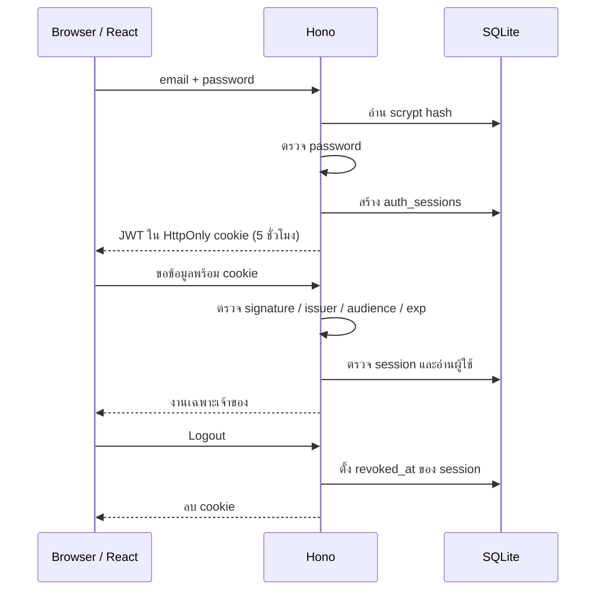
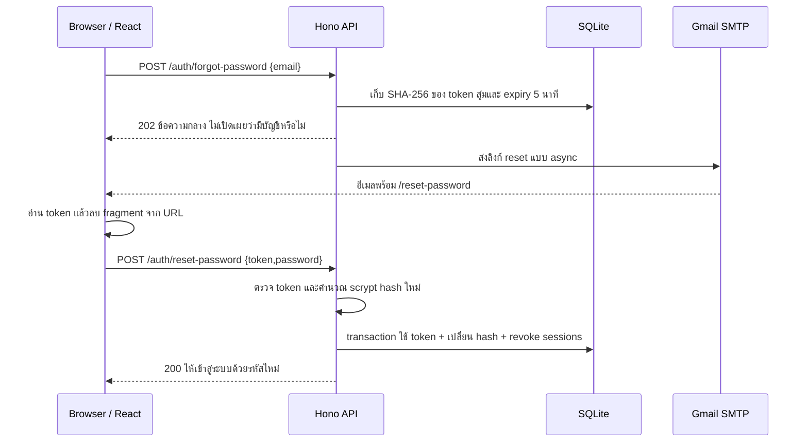

# คู่มือพรีเซนต์ TaskFlow และตอบ Code Review

เป้าหมายคือให้ผู้ฟังเห็นว่า **หนึ่งการกระทำบนเว็บเดินผ่าน React → Hono → SQLite อย่างไร** เหตุใดคนหนึ่งจึงอ่านหรือแก้งานของอีกคนไม่ได้ และผู้ใช้กู้บัญชีผ่านลิงก์อีเมลได้อย่างไร ใช้ diagram ชี้ทางก่อนเปิดโค้ด ไม่ต้องอ่านทุกบรรทัดในสไลด์ รุ่นนี้อัปเดตเนื้อหาวันที่ 14 ตุลาคม 2569

ใช้ [PowerPoint ฉบับอัปเดต 24 หน้า](../presentation/output/TaskFlow-Code-Review-Updated-2026-10-14.pptx) และเปิด Speaker Notes ใต้แต่ละสไลด์เพื่ออ่านหน้าที่ หัวใจหลัก และแนวตอบคำถาม

## สิ่งที่ต้องเข้าใจให้ได้ก่อนขึ้นพรีเซนต์

พูดประโยคต่อไปนี้ด้วยคำของตัวเองได้:

1. “TaskFlow เป็นเว็บงานส่วนตัว แต่ละงานมีเจ้าของหนึ่งคน Backend ตรวจเจ้าของจาก session ทุกครั้ง”
2. “เว็บใช้ JWT ใน cookie สำหรับผู้ใช้ ส่วน n8n ใช้ API key ที่อ่านงานเตือนเฉพาะเจ้าของ key”
3. “เก็บ web/api/shared ใน monorepo เพื่อใช้กติกาข้อมูลร่วมกัน แต่ข้อมูลจาก HTTP ยังต้องตรวจตอน API ทำงาน”
4. “ลืมรหัสผ่านใช้ token สุ่มอายุ 5 นาที ไม่ใช้ JWT หรือ API key แทน เมื่อใช้สำเร็จจะเปลี่ยน password hash และยกเลิก session เดิมทั้งหมด”

ถ้าศัพท์ใดยังอธิบายไม่ได้ ให้ดู [glossary](./glossary.md) แล้วโยงกลับมาที่ปุ่ม/route/ตารางจริง หลีกเลี่ยงเพิ่มศัพท์ในสไลด์เพียงเพื่อให้งานดูซับซ้อน

## เตรียมเดโมก่อนเริ่ม

เปิดเว็บที่ `http://localhost:5173` ด้วย `npm run dev` หรือ build แล้วใช้ `npm start` ที่ `http://localhost:3000` เลือกวิธีเดียวตลอดเดโม บัญชีเดโมและคำสั่ง setup อยู่ใน [README](../README.md)

`npm run dev` ที่ root สั่ง `concurrently` เปิด frontend พอร์ต 5173 กับ backend พอร์ต 3000 เป็นคนละ process ก่อนรันให้หยุดตัวที่เปิดแยกใน IntelliJ หรือ Terminal เดิม ไม่เปิดซ้ำ หากขึ้น `EADDRINUSE` มี process ใช้พอร์ตอยู่แล้ว หากหน้าเว็บขึ้นเชื่อมต่อ API ไม่สำเร็จ ให้ดูว่า backend แสดง `TaskFlow API ready` และเปิด `/api/health` ได้หรือไม่ เปิด Terminal ค้างไว้ระหว่างเดโม

เตรียมเปิดไฟล์ `packages/shared/src/index.ts`, `apps/api/src/tasks.ts`, `apps/api/src/auth.ts`, `apps/api/src/security.ts`, `apps/api/src/password-reset.ts`, `apps/api/src/mail.ts` และ `apps/api/src/schema.sql` ไว้ก่อน ไม่ใช้เวลาพรีเซนต์ค้นชื่อไฟล์ เตรียมชื่อ task เช่น “ส่งสรุป Code Review” พร้อมคำอธิบายหนึ่งบรรทัดและกำหนดส่งเป็นวันนี้ของไทย

ใช้ข้อมูลเดโมของตัวเอง เลือก task ที่ลบได้สำหรับสาธิต DELETE และสร้าง API key ชื่อ “demo reminder” สำหรับสาธิตการเพิกถอน Key ใหม่แสดง secret ครั้งเดียว แต่ไม่จำเป็นต้องฉาย secret เต็มให้ผู้ชม ถ้า SMTP ยังไม่ตั้งค่า ให้เปิด workflow อธิบาย flow โดยไม่กดส่งอีเมล

การสาธิตลืมรหัสผ่านต้องใช้บัญชีที่สมัครด้วยอีเมลรับจริง บัญชี `demo@taskflow.local` รับเมลไม่ได้ ตั้ง Gmail SMTP ตาม [คู่มือ](./password-reset-gmail.md) และรัน `npm run mail:check` ก่อน การตรวจผ่านหมายถึงเชื่อมต่อและ login SMTP ได้ ยังไม่ยืนยันว่าอีเมลถึง inbox ไม่ฉาย `.env`, App Password หรือ reset link เต็มให้ผู้ชม หากยังไม่มีหลักฐานส่งผ่าน Gmail จริง ให้ใช้ screenshot และ diagram อธิบายพร้อมระบุขอบเขตที่ตรวจแล้ว

## ลำดับการเล่า 12–15 นาที

เวลาคือแนวทาง สามารถขยับตามความคล่องของเดโม ไม่ผูกกับหมายเลขสไลด์

| เวลา | แสดงอะไร | ใจความที่ควรพูด |
| --- | --- | --- |
| 0:00–0:45 | ปัญหาและหน้าเว็บ | “เราเก็บงาน วันส่ง และสถานะไว้ที่เดียว แต่ละคนเข้าถึงเฉพาะงานตัวเอง” |
| 0:45–1:45 | Diagram ภาพรวมและ monorepo | “React แสดงผล Hono ตรวจข้อมูลและสิทธิ์ SQLite เก็บข้อมูล npm script เปิดสอง process ให้ ส่วน shared package ลดกติกาซ้ำ” |
| 1:45–3:30 | Login แล้วเพิ่ม/แก้/ค้นหางาน | “ข้อมูลผ่าน validation และบันทึกจริง PATCH เปลี่ยนเฉพาะ field ที่ส่ง” |
| 3:30–4:45 | `tasks.ts` และ SQL | “ID เลือกงาน user_id จาก session ตรวจเจ้าของ Prepared parameters แยกค่าจากคำสั่ง SQL” |
| 4:45–6:00 | Diagram login/session | “scrypt ตรวจรหัสผ่าน JWT ตรวจลายเซ็นและวันหมดอายุ SQL session ทำให้เพิกถอนได้” |
| 6:00–8:45 | หน้าลืมรหัสผ่านและ diagram reset | “ส่งลิงก์ทาง Gmail SMTP token สุ่ม 5 นาทีใช้ครั้งเดียว เปลี่ยน hash และยกเลิก session ใน transaction แล้ว login ใหม่” |
| 8:45–10:00 | หน้า API key และ n8n | “API key สำหรับเตือนงานแยกจาก reset token และ SMTP ของ password reset ไม่ต้องผ่าน n8n” |
| 10:00–11:15 | หลักฐานและข้อจำกัด | “54 tests ผ่าน รวม SMTP ในเครื่อง ยังไม่มีหลักฐาน Gmail ถึง inbox และ n8n ตรวจแบบ static” |
| 11:15–14:00 | ลบข้อมูลเดโม/ยกเลิก key/logout และถามตอบ | “ชี้ route หรือ test ที่รองรับคำตอบ ไม่แสดง secret และไม่อ้างผลที่ยังไม่ได้ตรวจ” |

เดโม CRUD ควรทำให้จบหนึ่งวงจร: เพิ่มชื่อ/คำอธิบาย/วันส่ง → เปลี่ยนสถานะ → ค้นหาชื่อ → แก้ชื่อหรือวันส่ง → ลบ task เดโม ถ้าเวลาไม่พอ ให้แสดงลบช่วงท้ายแทนการเพิ่ม task หลายรายการ

## จุดเปิดโค้ดที่ช่วยอธิบายภาพรวม

### หนึ่ง task มีเจ้าของอย่างไร

ใน `tasks.ts` ให้ชี้เฉพาะเงื่อนไขสำคัญ:

```sql
SELECT id,title,description,priority,status,due_date,created_at,updated_at
FROM tasks
WHERE id = ? AND user_id = ?;
```

`id` มาจาก URL ส่วน `user_id` มาจาก session ที่ตรวจแล้ว `?` คือ placeholder สำหรับ bind parameter ค่าเหล่านี้ไม่ถูกนำมาต่อเป็น SQL string เมื่อคนอื่นส่ง ID นี้มา ระบบหาไม่พบสำหรับผู้ใช้คนนั้นและคืน 404 ไม่จำเป็นต้องแสดงว่า task ของใครมีอยู่

### Login เชื่อมกับ Logout อย่างไร



JWT ในงานนี้ใช้ `jose` เป็นตัว sign/verify ไม่ต้องสร้าง cryptography เอง การมี session ใน SQL ทำให้ JWT ที่คัดลอกก่อน logout ใช้ต่อไม่ได้หลัง session ถูกเพิกถอน

### ลืมรหัสผ่านเชื่อมกับการยกเลิก session อย่างไร



การขอลิงก์อย่างเดียวยังไม่เปลี่ยนรหัสผ่าน Token ไม่มีข้อมูลผู้ใช้ในตัว เก็บเฉพาะ digest ใน `password_reset_tokens` การใช้ลิงก์สำเร็จจะยกเลิกลิงก์อื่นที่ยังค้างของเจ้าของด้วย แต่ไม่กระทบบัญชีอื่น หากเปิดลิงก์แล้ว refresh token ในหน่วยความจำจะหาย ให้กลับไปเปิดจากอีเมลต้นฉบับใหม่

Transaction รวมการแก้ข้อมูลใน SQL ให้สำเร็จร่วมกัน การส่ง SMTP อยู่ภายนอก transaction และงานที่รอส่งอยู่ใน process หาก server หยุดระหว่างส่งอาจต้องขอลิงก์ใหม่ จึงแยกคำว่า “รับคำขอแล้ว”, “SMTP รับข้อความแล้ว” และ “ถึง inbox แล้ว” ออกจากกัน

### แต่ละส่วนทำหน้าที่อะไร

| ส่วนจริงในโปรเจกต์ | ใช้ทำอะไร | หัวใจหลัก |
| --- | --- | --- |
| React / `apps/web/src/App.tsx` | ฟอร์ม รายการงาน filter loading/error | UI สื่อสารกับ API และแสดงข้อมูล ไม่ใช่ผู้ตัดสินสิทธิ์ |
| Tailwind | Layout สี ระยะห่าง responsive | ทำหน้าจอให้สม่ำเสมอ ไม่เกี่ยวกับ authentication |
| Hono / `app.ts` | ประกอบ HTTP routes และ middleware | เลือก handler และใช้กติกากลางก่อนทำงาน |
| `auth.ts` + `security.ts` | Password, JWT, session | รู้ตัวตนที่เชื่อถือได้และควบคุมอายุ credentials |
| `password-reset.ts` + `mail.ts` | ลิงก์อีเมลและตั้งรหัสใหม่ | Token ใช้ครั้งเดียวและเปลี่ยน hash พร้อมยกเลิก sessions |
| `tasks.ts` | CRUD/search/summary | ทุกงานอยู่ในขอบเขตผู้ใช้ที่ตรวจแล้ว |
| `schema.sql` + `db.ts` | เปิด SQLite และกำหนดตาราง/constraints | เก็บข้อมูลถาวรและปฏิเสธข้อมูลผิดบางประเภท |
| `packages/shared/src/index.ts` | Zod schemas และ TS types | ลดการกำหนดรูปแบบข้อมูลซ้ำและตรวจ input จริง |
| `integrations.ts` | Key/due tasks/receipt history | Automation ใช้สิทธิ์เฉพาะของเจ้าของ key |
| Vite + npm workspaces | พัฒนา frontend และเชื่อม packages | รันสะดวกและแชร์ code ภายใน repo |
| n8n + SMTP | ตั้งเวลา เรียก API และส่งเมล | Automation เสริมผ่าน API ไม่อ่าน SQL โดยตรง |

## คำถาม Code Review 20 ข้อ พร้อมแนวตอบ

### 1. JWT คือการเข้ารหัสข้อมูลหรือไม่?

แบบ signed JWT ที่ใช้ใน TaskFlow อ่าน header/payload ได้ ลายเซ็นช่วยตรวจว่าถูกแก้ไขหรือไม่ Backend ต้อง **verify** ก่อนเชื่อข้อมูล การ decode อย่างเดียวไม่ตรวจลายเซ็น เราไม่ใส่ password หรือ key secret ใน payload และตรวจ algorithm HS256, issuer, audience และ expiration ใน `security.ts`

### 2. ทำไม password ใช้ scrypt แต่ API key ใช้ SHA-256?

Password คนตั้งมีโอกาสเดาได้ จึงใช้ scrypt ที่เพิ่มต้นทุนการเดาและ salt สุ่มต่อบัญชี API key สร้างจาก random bytes จำนวนมาก จึงใช้ SHA-256 digest สำหรับ lookup ได้ Salt เก็บร่วมกับ password hash ไม่ใช่ความลับ และ password เดียวกันของสองบัญชีจะได้ hash ต่างกัน ดู `hashPassword()` และ `hashApiKey()`

### 3. HttpOnly cookie กัน CSRF และ XSS ได้ครบหรือไม่?

HttpOnly ป้องกัน JavaScript อ่าน cookie โดยตรง แต่ XSS ยังอาจสั่ง request ในนามผู้ใช้ได้ Browser ส่ง cookie อัตโนมัติจึงต้องคิดเรื่อง CSRF งานนี้ใช้ SameSite=Lax และตรวจ Origin/`sec-fetch-site` ของ mutation ใน `app.ts` ไม่ได้ใช้ CSRF token แยก เราไม่อ้างว่า cookie อย่างเดียวกำจัดทุกความเสี่ยง Production ตั้ง Secure และใช้ HTTPS ด้วย

### 4. Authentication ต่างจาก Authorization ตรงไหน?

Authentication รู้ว่าผู้เรียกคือ user ใดจาก JWT/session หรือ API key ส่วน Authorization ตัดสินว่าผู้เรียกแก้ task นี้ได้หรือไม่ คนที่ login แล้วอาจไม่มีสิทธิ์ใน task ของคนอื่น สองขั้นจึงต้องทำครบ

### 5. ทำไม WHERE ต้องมีทั้ง id และ user_id?

รู้ ID ไม่ได้หมายถึงเป็นเจ้าของ `WHERE id=? AND user_id=?` ทำให้ตรวจเจ้าของพร้อมเลือกข้อมูล `user_id` มาจากตัวตนที่ backend ตรวจแล้ว ไม่อ่านจาก form ผู้ใช้ ทั้ง GET/PATCH/DELETE ใช้แนวคิดนี้ และ tests ตรวจ cross-user ว่าได้ 404

### 6. Prepared SQL และ parameter ช่วยอะไร?

Prepared statement แยกโครงสร้างคำสั่งออกจากค่าที่ bind ลง `?` จึงไม่เอาคำค้น/title มาต่อ SQL และตีความเป็นคำสั่งใหม่ Column ของ filter มาจากโค้ดที่กำหนดไว้ ส่วนค่าผ่าน enum validation การค้นหาใช้ `instr` ให้ `%` เป็นตัวอักษรจริง ไม่ใช่ wildcard Tests ส่งคำค้นลักษณะ SQL injection แล้วข้อมูลยังอยู่และไม่หลุดข้ามบัญชี

### 7. Foreign Key ตรวจสิทธิ์ให้แล้ว ทำไมยังต้องตรวจ owner?

Foreign Key ตรวจว่าค่าอ้างอิงมีแถวอยู่จริง เช่น `tasks.user_id` อ้าง users แต่ไม่ได้รู้ว่าคนเรียก HTTP มีสิทธิ์แก้ task หรือไม่ อีกกรณี `reminder_deliveries` มี FK ของ user กับ task แยกกัน จึงต้องให้ API ตรวจ task owner ก่อนบันทึกด้วย FK ไม่ได้แทน permission check

### 8. “วันนี้” และวันครบกำหนดใช้ timezone ไหน?

API ใช้ `Asia/Bangkok` ผ่าน `bangkokDate()` วันครบกำหนดเป็น `YYYY-MM-DD` ของปฏิทิน ไม่ใช่เวลาที่ต้องแปลง UTC ส่วน `created_at` เป็น ISO timestamp กรณี n8n ไม่ส่ง date query API คืนวันนี้ของไทย และ workflow ใช้ date จากผล GET เดิมตอนบันทึก receipt ไม่คำนวณใหม่เอง

### 9. ทำไม n8n ใช้ HTTP และ API key แทน password หรืออ่าน SQL ตรง?

ให้ backend เป็นผู้รักษากติกาเดียวกัน Key ผูกกับผู้ใช้ มี scope `reminders`, หมดอายุใน 30 วัน และเพิกถอนได้ Key ไม่ให้ login ผ่านเว็บหรือเรียก task CRUD ของเว็บ n8n เก็บ key ใน Credentials แล้วส่งผ่าน `x-api-key` ไปสอง integration endpoints ไม่เก็บ secret ใน workflow JSON

### 10. PATCH ส่งแค่ title แล้ว fields อื่นหายหรือไม่?

ไม่หาย Create schema มี defaults แต่ update schema ใช้ fields ที่ไม่มี defaults แล้วทำให้ optional และปฏิเสธ PATCH ว่าง Backend merge เฉพาะ fields ที่ตรวจแล้วเข้ากับข้อมูลเดิม ใน Zod 4 ถ้า reuse create schema ที่มี defaults อย่างไม่ระวัง อาจเติม defaults ให้ fields ที่ไม่ได้ส่ง จึงมี regression test สำหรับกรณีนี้

### 11. Logout แค่ลบ cookie เพียงพอหรือไม่?

ไม่พอสำหรับ token ที่ถูกคัดลอกไปแล้ว งานนี้ตั้ง `auth_sessions.revoked_at` ใน SQL แล้วลบ cookie Request ถัดไปตรวจ session ทุกครั้ง จึงปฏิเสธ token เดิม แม้ JWT ยังไม่ครบ 5 ชั่วโมง รุ่นนี้ไม่มี refresh token ผู้ใช้ login ใหม่เมื่อหมดอายุ

### 12. ทำไมเลือก SQLite และมีข้อจำกัดอะไร?

เป็น SQL จริงและเก็บเป็นไฟล์ เปิดเดโมได้โดยไม่ตั้ง database server ใช้ `node:sqlite` กับ prepared queries สำหรับงานหนึ่งเครื่อง โค้ด DatabaseSync query แบบ synchronous และการเขียนพร้อมกันมีข้อจำกัด จึงยังไม่ได้พิสูจน์การรองรับผู้ใช้จำนวนมาก รุ่นนี้สร้าง schema แรกด้วย `CREATE TABLE IF NOT EXISTS` แต่ยังไม่มี migration สำหรับรุ่นถัดไป

### 13. Monorepo ช่วยอะไร และ TypeScript แทน validation ได้ไหม?

web/api/shared อยู่ใน repo เดียว npm workspaces เชื่อม packages จึงแก้รูปแบบข้อมูลที่ใช้ร่วมกันใน change เดียว TypeScript ตรวจตอนเขียน/build แต่ชนิดข้อมูลหายไปเมื่อรัน JavaScript และ HTTP อาจมาจากใครก็ได้ Zod จึงตรวจ body จริงที่ backend ด้วย Monorepo ไม่ได้บังคับว่าต้อง deploy ทุก app เป็น service เดียว

### 14. Rate limit กันการเดารหัสผ่านได้ทุก instance หรือไม่?

ไม่ใช่ งานนี้จำกัด login/register 20 ครั้งใน 15 นาทีต่อ IP โดยนับใน memory ของ process รีสตาร์ทแล้วตัวนับหาย และหลาย instance ไม่แชร์ตัวนับ เป็นขอบเขตของเดโมหนึ่ง server ต้องปรับเมื่อออกแบบ deployment จริง Tests ตรวจ threshold, Retry-After และการแยก client

### 15. n8n กันส่งซ้ำและยืนยันอีเมลถึงผู้รับได้ไหม?

GET ไม่นำงานที่มี receipt ของวันเดียวกันมาส่งอีก และ SQL UNIQUE กัน receipt ซ้ำตาม user/task/date/channel แต่ SMTP กับ SQL เป็นคนละระบบ ถ้าส่งสำเร็จแล้วบันทึกล้มเหลว หรือรัน workflow ซ้อนกัน ยังอาจส่งซ้ำได้ SMTP ตอบรับเพียงหมายถึงรับส่งต่อ ไม่ได้ยืนยันเข้ากล่อง/ถูกอ่าน งานค้างอาจเตือนใหม่วันถัดไป และ workflow นี้คืนสูงสุด 100 งานต่อรอบ ดู [ข้อจำกัด n8n](./n8n-setup.md)

### 16. ทำไม reset token แยกจาก JWT และ API key?

JWT ใช้กับ session หน้าเว็บอายุ 5 ชั่วโมง API key ใช้ integration scope reminders อายุ 30 วัน ส่วน reset token ให้สิทธิ์เปลี่ยนรหัสผ่านเพียงครั้งเดียวใน 5 นาที จึงแยก endpoint, ตารางและการตรวจ ไม่รับ JWT หรือ API key แทน reset token ลิงก์ส่งถึงอีเมลที่ผูกกับบัญชี และไม่มี token ฉบับเต็มใน SQL

### 17. ถ้ามีคนกดลิงก์เดียวกันพร้อมกันสองครั้งจะเกิดอะไร?

หลังตรวจและคำนวณ password hash ระบบเปิด transaction แล้ว UPDATE token โดยมีเงื่อนไข `used_at IS NULL` และ `expires_at > now` ต้องเปลี่ยนได้หนึ่งแถวเท่านั้นจึงไปต่อ การใช้สำเร็จครั้งแรกตั้ง used_at และยกเลิกลิงก์อื่นของเจ้าของ ส่วนคำขอที่ตามมาคืน `INVALID_RESET_TOKEN` Tests ตรวจว่าคำขอพร้อมกันได้ผลสำเร็จเพียงหนึ่งคำขอ

### 18. ถ้ากำลัง login ด้วยรหัสเก่าขณะ reset สำเร็จ จะหลุดสร้าง session ได้ไหม?

Login อ่าน hash เดิมแล้วรอ scrypt ซึ่งอาจเปิดโอกาสให้คำขอ reset เปลี่ยน hash ระหว่างนั้น โค้ดจึงอ่าน `password_hash` ล่าสุดอีกครั้งหลังตรวจรหัสผ่านและก่อนสร้าง session ต้องตรงกับ snapshot ที่เพิ่งตรวจ มิฉะนั้นปฏิเสธ credentials พร้อมมี regression test สำหรับจังหวะนี้ Session ที่มีอยู่ก่อน reset ก็ถูก revoke ทั้งหมด

### 19. ขอลิงก์แล้วบอกว่า “ไม่พบอีเมล” ได้ไหม และกัน spam อย่างไร?

รุ่นนี้ใช้ข้อความ HTTP 202 แบบเดียวกันสำหรับอีเมลที่มีและไม่มีบัญชี เพื่อลดการเปิดเผยรายชื่อบัญชี ส่ง SMTP หลังรับคำขอเพื่อลดความต่างของเวลารอเครือข่าย มี rate limit ขอลิงก์ 5 ครั้ง/IP/15 นาที และส่งรหัสใหม่ 10 ครั้ง/IP/15 นาที ส่วนการส่งต่อบัญชีเว้นอย่างน้อย 60 วินาทีและไม่เกิน 3 ฉบับ/ชั่วโมง หากยังไม่มี SMTP ตอบ 503 เหมือนกันทุกอีเมล ตัวนับ IP อยู่ใน memory ส่วนประวัติต่อบัญชีอ่านจาก SQL

### 20. Gmail reset ต่างจากอีเมลเตือนของ n8n อย่างไร?

Password reset ส่งจาก Hono ผ่าน Nodemailer ไป Gmail SMTP โดยตรง จึงไม่ต้องเปิด n8n ส่วนอีเมลเตือนงานเป็น workflow ของ n8n ที่ใช้ API key อ่านงานและส่งผ่าน SMTP ที่ตั้งใน n8n แยกกัน `mail:check` ตรวจเพียงการเชื่อมต่อและ login ไม่ส่งข้อความ ผล SMTP ในเครื่อง 2 tests ไม่ยืนยัน Gmail ถึง inbox ต้องสาธิตด้วยบัญชีรับจริงจึงอ้างผลนั้นได้

## หลักฐานที่กล่าวอ้างได้ในงานนี้

| ตรวจอะไร | ผลและความหมาย |
| --- | --- |
| `npm test` | **54/54 ผ่าน** แบ่งเป็น API เดิม 35, password reset 17 และ email configuration/local SMTP 2 ใช้ SQLite จริงใน memory |
| Test เนื้อหาสำคัญ | JWT/session/logout, ownership, PATCH preservation, input/origin/rate, key scope, receipt dedup/rollback, SQL และ reset token expiry/replay/concurrency/session revocation |
| TypeScript + build | ผ่าน ตรวจชนิดข้อมูลและสร้าง frontend build ได้ |
| Browser UI จริง | ตรวจ CRUD/login/key ตามเดิม และตรวจหน้าขอ reset/ตั้งรหัสใหม่ที่ 320–1440px รวมข้อความ SMTP ยังไม่ตั้งค่าและการลบ fragment จาก URL |
| n8n workflow | JSON/graph/schedule/expressions/plaintext newline และ Docker Compose configuration ผ่าน **static validation** |
| SMTP ของ password reset | ทดสอบส่งข้อความผ่าน SMTP receiver ในเครื่องจริง อ่านลิงก์จากข้อความแล้ว reset/login ด้วยรหัสใหม่สำเร็จ |
| Gmail/inbox และ n8n runtime | ยังไม่มีหลักฐานยืนยันการส่งผ่าน Gmail จริง/ถึง inbox หรือการรัน n8n ส่งจริง การตั้งค่า credential ไม่เท่ากับผลส่งสำเร็จ |

Tests ผ่านเป็นหลักฐานของพฤติกรรมที่ตรวจ ไม่ใช่การรับรองทุกกรณี ยังไม่มี load test, deployment จริง, Gmail/inbox delivery หรือ workflow execution จริง อย่าเพิ่มผลทดสอบที่ไม่ได้ทำลงในสไลด์

## อ้างอิงวิดีโออย่างตรงไปตรงมา

คลิป API/Auth อ่านคำบรรยายอังกฤษอัตโนมัติครบตั้งแต่ 00:00–01:44:21 และศึกษา repo ของผู้สอน คำบรรยายอาจถอดศัพท์ผิด ส่วนคลิป Monorepo ไม่มี transcript ให้ export จึงใช้หน้าอธิบาย รายการบท และ repo ที่ผู้สอนเชื่อมโดยตรง การศึกษานี้ไม่อ้างว่าดูภาพ/ฟังเสียงครบทั้งสองคลิป รายละเอียดและ URL อยู่ใน [video-study](./video-study.md)

อธิบายให้ชัดว่า TaskFlow ใช้แนวคิดจากคลิปและเลือก implementation ตามขอบเขตงาน เช่น npm แทน pnpm, SQLite แทน PostgreSQL, JWT cookie พร้อม SQL session 5 ชั่วโมงแทนตัวอย่าง Bearer token 5 นาที และเพิ่ม n8n เอง ผู้ฟังจึงแยกได้ว่าส่วนใดมาจากบทเรียนและส่วนใดเราตัดสินใจ

ถ้าถูกถามเรื่องที่ยังไม่ทำ ให้ตอบสั้น ๆ ว่า “รุ่นนี้ยังไม่มีส่วนนั้น ขอบเขตที่ทดสอบแล้วคือ… ถ้าจะเพิ่มต้องออกแบบ…ก่อน” แล้วชี้ข้อจำกัดที่บันทึกไว้ ไม่จำเป็นต้องตอบด้วยศัพท์ใหม่ที่ยังไม่เข้าใจ
