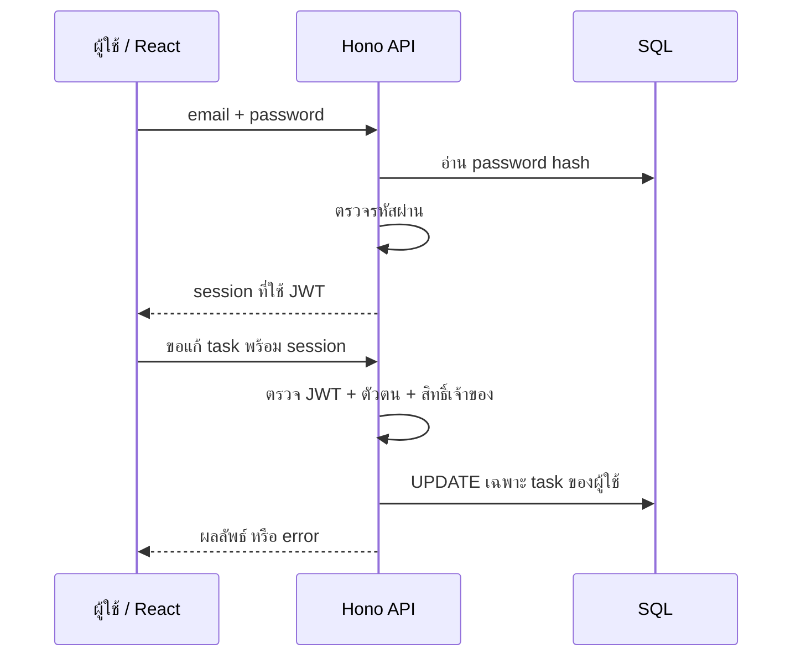

# บันทึกการศึกษาวิดีโอและการประยุกต์กับ TaskFlow

ตรวจสอบแหล่งข้อมูลวันที่ 13 ตุลาคม 2026 โดยแยก **สิ่งที่ยืนยันจากผู้สอน** ออกจาก **การตัดสินใจของโปรเจกต์นี้**

## ขอบเขตการเข้าถึงวิดีโอ

**คลิป API/Auth:** ดึงคำบรรยายภาษาอังกฤษจาก YouTube ผ่าน browser export และอ่านครบทั้งไฟล์ ตั้งแต่ 00:00 ถึง 01:44:21 พร้อมตรวจคำอธิบาย รายการบท และ repository ในบัญชีผู้สอน คำบรรยายระบุว่าเป็น **auto-generated captions** จึงอาจมีการถอดเสียงผิด โดยเฉพาะชื่อ function/คำศัพท์เทคนิค การศึกษานี้เป็นการอ่านคำบรรยายครบ ไม่ใช่การยืนยันว่าดูภาพและฟังเสียงครบทั้งวิดีโอ

**คลิป Monorepo:** browser export แจ้งว่าไม่มี transcript ให้ใช้ จึงศึกษาจากชื่อ/metadata/คำอธิบาย/รายการบท รวมทั้งหน้าเว็บผู้สอนและ repository ที่ผู้สอนเชื่อมโดยตรง ไม่อ้างว่าอ่านคำบรรยายหรือดูจบคลิปนี้ เวลาอ้างอิงด้านล่างมาจากรายการบทจริง ไม่มีการสร้างเวลาขึ้นเอง

ไม่แนบหรือคัดลอก transcript เต็มลงในผลงานนี้ สรุปเฉพาะประเด็นที่เกี่ยวข้องเป็นภาษาไทย และใช้เอกสารทางการของเครื่องมือ/มาตรฐาน JWT ตรวจความเข้าใจเพิ่ม ข้อเสนอด้านความปลอดภัยในหัวข้อคำสำคัญเป็นการประยุกต์จากแหล่งที่ระบุ ไม่ใช่การอ้างว่าผู้สอนพูดทุกประเด็นนั้น

## 1. How To Build A Production Ready API - Auth, JWT, API Keys

- ผู้เผยแพร่: **Web Dev Simplified**; ผู้สอน Kyle Cook
- เผยแพร่: **26 พฤษภาคม 2026** ตาม metadata ของ YouTube
- [วิดีโอต้นฉบับ](https://www.youtube.com/watch?v=U_D14T5TYuk)
- [Newsletter ของผู้สอนที่อธิบายวิดีโอนี้](https://web-dev-simplified.kit.com/posts/new-javascript-features-es2027)
- [Repository ที่พบในบัญชีผู้สอน](https://github.com/WebDevSimplified/hono-api-with-auth-crash-course)

คำบรรยายและคำอธิบายผู้สอนยืนยันการสร้าง library API ด้วย Hono/TypeScript และ Requestly ส่วน package.json ใน repository ยืนยัน Hono, Node.js, Zod, Drizzle และ PostgreSQL อย่างไรก็ตาม URL เต็มของลิงก์ GitHub ในคำอธิบาย YouTube ยังอ่านไม่ได้ จึงระบุ repo นี้ว่าเป็นงานตรงหัวข้อในบัญชีผู้สอน ไม่อ้างว่าตรวจลิงก์วิดีโอ→repo โดยตรง

สิ่งที่ยืนยันจากการอ่านคำบรรยายครบ:

- แบ่ง Hono routes และใช้ Zod ตรวจ JSON ก่อนเรียก handler; เริ่ม CRUD ในหน่วยความจำแล้วเปลี่ยนเป็น PostgreSQL/Drizzle พร้อม migrations
- Password ใช้ scrypt กับ salt สุ่ม และเปรียบเทียบด้วย `timingSafeEqual`; login ใช้ข้อความผิดพลาดเดียวกันสำหรับ email/password ผิด
- Login ออก JWT ที่มี user ID/email/เวลาหมดอายุ ตัวอย่างอายุ 5 นาที ใช้ HS256 และ Bearer header สำหรับจัดการ API key
- Key สุ่ม 32 bytes เก็บ SHA-256 digest และ prefix คืน secret เฉพาะตอนสร้าง; การ list/delete จำกัดตามผู้ใช้เจ้าของ
- API key middleware ป้องกัน mutation; หนังสือให้ผู้ใช้แก้/ลบของตนเอง และให้ admin จัดการได้กว้างขึ้น
- ทดสอบ request ต่อเนื่องด้วย variables ใน Requestly รวมถึงเปลี่ยนบัญชีตรวจว่าแก้หนังสือคนอื่นไม่ได้ [คำบรรยายจากวิดีโอต้นฉบับ](https://www.youtube.com/watch?v=U_D14T5TYuk)

บทที่เกี่ยวข้องจากรายการบทของวิดีโอ:

| เวลาเริ่ม | หัวข้อ | สิ่งที่นำมาศึกษา |
| --- | --- | --- |
| 00:01:15 | ตั้งค่า Hono | ตั้ง backend ที่รับ HTTP request |
| 00:02:37 | Routing พื้นฐาน | กำหนด method และ URL |
| 00:10:24 | CRUD ของผู้เขียน | เพิ่ม อ่าน แก้ไข ลบข้อมูล |
| 00:25:58 | ตั้งค่าฐานข้อมูล | เก็บข้อมูลถาวร |
| 00:41:25 | ตั้งค่า Auth/JWT | เข้าสู่ระบบและพิสูจน์ตัวตน |
| 01:02:53 | ตั้งค่า API key | ให้ระบบอื่นเรียก API ด้วย credential |
| 01:30:55 | CRUD ของหนังสือ | ประยุกต์ routing และข้อมูลสัมพันธ์ |

## 2. Monorepos - What, Why, When and How | Full Stack React + Hono Example

- ผู้เผยแพร่: **Syntax**; ผู้สอน CJ
- เผยแพร่: **24 ธันวาคม 2024** ตาม metadata ของ YouTube
- [วิดีโอต้นฉบับ](https://www.youtube.com/watch?v=KIgPJT806D0)
- [หน้าเว็บของผู้สอน พร้อมรายการบทและลิงก์ code](https://syntax.fm/videos/syntax-side-dish-explainers/monorepos-what-why-when-and-how-or-full-stack-react-hono-example)
- [Repository ที่หน้าเว็บผู้สอนเชื่อมโดยตรง](https://github.com/w3cj/monorepo-example-tasks-app)

หน้าเว็บผู้สอนยืนยันว่าอธิบายความหมาย เหตุผล และช่วงที่ควร/ไม่ควรใช้ monorepo ผ่าน React frontend และ Hono API ตัวอย่าง README ยืนยันการใช้ pnpm workspaces, shared TypeScript/ESLint configuration, Zod validators, Vite API proxy และ Hono RPC client ตัวอย่างนั้นใช้ Cloudflare Workers/D1 สำหรับ deployment ซึ่งเป็นทางเลือกของผู้สอน ไม่ใช่สิ่งจำเป็นของ monorepo

บทสำคัญที่ตรวจได้จากหน้าเว็บผู้สอน:

| เวลาเริ่ม | หัวข้อ | ประโยชน์ต่อโปรเจกต์ |
| --- | --- | --- |
| 00:27 | ความหมาย monorepo | แยกแนวคิดการจัด repository ออกจาก runtime |
| 04:04 | เมื่อใดไม่ควรใช้ monorepo | พิจารณาต้นทุนการจัดการ |
| 09:52 | ตั้งค่า workspace | เชื่อม packages ใน repository เดียว |
| 12:45 | แชร์ configuration | ลด configuration ซ้ำ |
| 18:15 | Proxy สำหรับ API request | หน้าเว็บเรียก API ผ่าน URL เดียวขณะพัฒนา |
| 22:29 | แชร์ Hono types | ให้ frontend/backend เข้าใจรูปแบบข้อมูลตรงกัน |
| 26:15 | จัดโครงสร้างและจำกัด exports | เปิดเผยเฉพาะสิ่งที่ package ต้องให้ใช้ |

## หัวใจของคำสำคัญที่ควรอธิบายได้

### Authentication กับ Authorization

**Authentication** ตอบว่า “ผู้เรียกคือใคร” เช่น ตรวจ email/password แล้วสร้าง credential ให้ session ส่วน **Authorization** ตอบว่า “ผู้เรียกคนนี้ทำสิ่งนี้ได้หรือไม่” เช่น task หมายเลข 12 เป็นของผู้ใช้อีกคน จึงแก้ไม่ได้ แม้ login สำเร็จแล้ว

Backend ต้องตรวจสิทธิ์ทุก endpoint ที่เกี่ยวข้อง การซ่อนปุ่มใน React มีไว้ช่วย UX แต่ใครก็สามารถส่ง HTTP request เองได้ ข้อมูล `user_id` สำหรับการเป็นเจ้าของควรมาจากตัวตนที่ backend ตรวจแล้ว ไม่เชื่อค่าที่ผู้ใช้ส่งมาโดยตรง [OWASP REST Security](https://cheatsheetseries.owasp.org/cheatsheets/REST_Security_Cheat_Sheet.html#access-control)

### JWT

**JSON Web Token** เป็นรูปแบบบรรจุข้อมูลยืนยัน เช่น `sub` ผู้ใช้, `exp` เวลาหมดอายุ, `iss` ผู้ออก และ `aud` ผู้รับ แบบ signed JWT ที่ใช้ทั่วไปมี `header.payload.signature` ลายเซ็นช่วยตรวจการแก้ไข แต่ payload ของแบบ signed ที่ไม่เข้ารหัสยังอ่านได้ จึงไม่ใส่รหัสผ่านหรือ secret ใน payload [RFC 7519](https://www.rfc-editor.org/rfc/rfc7519)

`decode()` คืออ่านข้อมูล ไม่ใช่พิสูจน์ความถูกต้อง ส่วน `verify()` ตรวจลายเซ็นกับ algorithm ที่ backend กำหนด และตรวจ claims ตาม policy ต้องออก token ที่มีวันหมดอายุและตรวจจริง ถ้าจะออกจากระบบก่อนหมดอายุ ต้องออกแบบ session revocation เพิ่ม; JWT เพียงอย่างเดียวไม่ได้รับประกันการเพิกถอนทันที [Hono JWT helper](https://hono.dev/docs/helpers/jwt)



### API key

Credential สำหรับ integration เช่น n8n เรียก TaskFlow ตามเวลานัด แยกจากการ login ผ่านหน้าเว็บ ในโปรเจกต์นี้ key ผูกกับผู้ใช้เจ้าของงาน จึงต้องตรวจทั้ง key และขอบเขตข้อมูลที่ key เข้าถึง Key เป็นความลับ: เก็บใน n8n Credentials ส่งผ่าน HTTP header และเพิกถอนได้ ไม่ฝังใน frontend bundle หรือ URL [OWASP API keys และข้อมูลลับใน HTTP](https://cheatsheetseries.owasp.org/cheatsheets/REST_Security_Cheat_Sheet.html#api-keys)

**JWT กับ API key ใช้ร่วมกันได้:** เว็บใช้ session ของคน ส่วน workflow ใช้ credential ของ integration การมี key ไม่ควรให้สิทธิ์อ่านงานทุกคน

### Monorepo และ Workspace

**Monorepo** คือจัดหลาย app/package ไว้ใน repository เดียว ส่วน **workspace** คือความสามารถของ package manager ที่เชื่อม packages ภายในและจัด dependency ให้ใช้ร่วมกัน การอยู่ repo เดียวไม่ได้แปลว่าต้อง deploy เป็น service เดียว [npm Workspaces](https://docs.npmjs.com/cli/v11/using-npm/workspaces/)

```text
TaskFlow/
├─ apps/web/         React + Tailwind UI
├─ apps/api/         Hono API + SQL access
├─ packages/shared/ types และ validation schemas
├─ docs/             คู่มือเรียนรู้และ code review
└─ n8n/              workflow เสริมสำหรับอีเมลเตือน
```

Shared types ช่วยให้พบความผิดพลาดขณะเขียน/build code แต่ข้อมูล HTTP จริงยังต้องตรวจตอน runtime เช่น title ว่าง หรือ due_date ผิดรูปแบบ จึงใช้ validation ที่ backend ด้วย Hono RPC เป็นอีกวิธีแชร์สัญญา API โดยอนุมาน type จาก routes; ไม่จำเป็นต้องใส่ RPC ถ้า shared schemas เพียงพอ [Hono RPC](https://hono.dev/docs/guides/rpc)

## การตัดสินใจของ TaskFlow ซึ่งไม่ใช่ข้ออ้างจากวิดีโอ

| สิ่งที่เลือก | ใช้ทำอะไร | เหตุผลที่ระดับกลางพอดี |
| --- | --- | --- |
| React + Tailwind | หน้ารายการงาน ฟอร์ม และสถานะ | ได้ฝึก component/state และออกแบบ UI |
| Hono + TypeScript | รับ request ตรวจข้อมูลและสิทธิ์ | ภาษาเดียวกันสองฝั่ง และ routing อ่านง่าย |
| npm workspaces | จัด web/api/shared ใน repo เดียว | เรียนหลัก monorepo โดยใช้ npm ที่มีอยู่แล้ว; ผู้สอนใช้ pnpm |
| SQLite | เก็บ users/tasks/credentials/ประวัติการเตือน | เป็น SQL จริง รันในเครื่องง่าย ไม่ต้องตั้ง database server |
| JWT session | พิสูจน์ผู้ใช้ที่เข้าสู่ระบบ | ต้องอธิบาย verification และข้อจำกัดการเพิกถอน |
| API key ของผู้ใช้ | ให้ n8n อ่านเฉพาะงานเจ้าของ key | สาธิต integration โดยไม่เปิดฐานข้อมูลให้ workflow |
| n8n แบบเลือกใช้ | อีเมลสรุปงานครบกำหนด 07:30 ไทย | เพิ่ม automation ได้โดย core To-do ยังทำงานเองได้ |

ระบบนี้เป็นงานเรียนรู้ที่ตั้งใจทำให้รันจริง ตรวจสอบได้ และมีข้อจำกัดชัดเจน คำว่า “Production Ready” ในชื่อวิดีโอไม่ใช่ใบรับรองของ TaskFlow ก่อนใช้งานภายนอกต้องมี HTTPS, secret จริง, backup/restore ที่ทดลองแล้ว และดูแล deployment ตาม README ของโปรเจกต์

TaskFlow ไม่ได้คัดลอกทุก implementation จากคลิป: ใช้ JWT 30 นาทีใน HttpOnly cookie พร้อม session ใน SQL ที่ logout แล้วเพิกถอนได้ ใช้ SQLite/prepared queries และงานส่วนตัวแทน library/admin ตัวอย่าง API key เพิ่มวันหมดอายุและ soft revocation ส่วน n8n เป็นการต่อยอดของงานนี้ ตัวเลขและกลไกเหล่านี้เป็นการตัดสินใจของ TaskFlow ไม่ใช่คำอ้างจากผู้สอน

## สิ่งที่ต่อยอดจาก FoodPreOrder อย่างวัดได้

ตรวจอ่าน README และ auth service ปัจจุบันของ `D:\PCCTH\foodpreorder-frontend` แบบอ่านอย่างเดียว พบว่าโปรเจกต์เดิมมี session restoration, refresh token, role guards และการทดสอบอยู่แล้ว จึงไม่ควรพูดกว้าง ๆ ว่า TaskFlow ปลอดภัยกว่าทุกด้าน

สิ่งที่งานนี้ปรับเพื่อการเรียนรู้และ code review คือ frontend/backend/shared อยู่ใน monorepo, มี domain เดียวที่ไล่ request ได้ง่าย, เอกสารเชื่อม UI → API → SQL, แยก JWT ของคนกับ key ของ integration และมี diagram/คำอธิบายสำหรับทุกศัพท์ที่ใช้ในสไลด์ อ่านผลการทดสอบจริงและข้อจำกัดจาก README/คู่มือพรีเซนต์ก่อนกล่าวอ้างผลลัพธ์

## คำถามซ้อมก่อนพรีเซนต์

1. Login สำเร็จแล้ว ทำไมยังแก้ task ของคนอื่นไม่ได้? — เพราะ authentication และ ownership authorization เป็นคนละขั้น
2. JWT อ่าน payload ได้หรือไม่? — แบบ signed ที่ใช้ทั่วไปอ่านได้; ลายเซ็นมีไว้ตรวจการแก้ไข
3. ทำไม n8n ไม่ใช้ password ของผู้ใช้? — ใช้ key ที่เพิกถอนได้และจำกัดเฉพาะ integration
4. TypeScript ตรวจ JSON จากอินเทอร์เน็ตให้เองไหม? — ไม่ จึงต้องมี runtime validation
5. ทำไมเลือก monorepo? — web/api ใช้ schemas ร่วมกันและแก้สัญญาข้อมูลใน change เดียว
6. ทำไมเลือก SQLite? — เป็น SQL จริงและลดขั้นตอนตั้งค่า เหมาะกับงานเรียนรู้หนึ่งเครื่อง
7. ส่งเมลแล้วถือว่าเข้ากล่องผู้รับแน่นอนไหม? — ไม่ SMTP accepted แปลว่า server รับส่งต่อ ยังอาจ bounce หรือเข้า spam
8. กันส่งซ้ำได้แน่นอนทุกกรณีหรือไม่? — ไม่ มีช่องว่างระหว่าง SMTP accepted กับการบันทึกประวัติ ดู [คู่มือ n8n](./n8n-setup.md)
